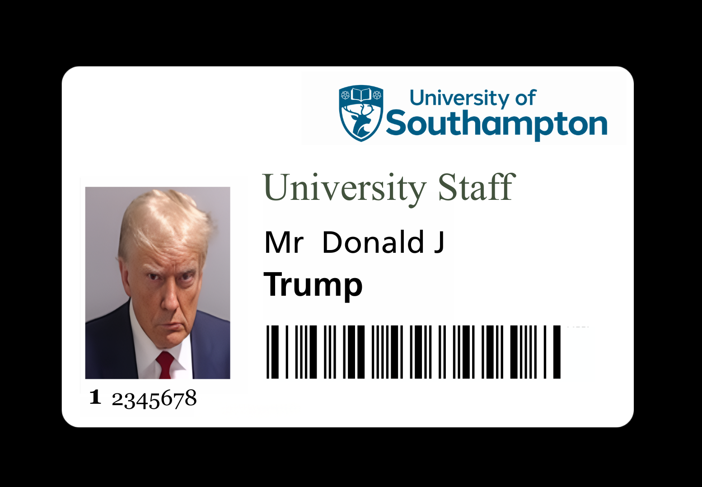

# 01 — Reconstructing a University ID Card from a Directory Dump

> **Scope:** Authorised lab exercise. The "target" is a **fabricated test identity**
> supplied by the module (a well-known public-figure name used deliberately as dummy
> data), queried from a **disabled, lab-only LDAP server**. No real person's data was
> used, and all identifying fields are redacted below.

## Context

Universities (and most large organisations) publish a surprising amount of identity
information through directory services. The lab provided the output of a single
`ldapsearch` query against a university-style LDAP server and asked: *given only this,
how faithfully can you reconstruct the holder's physical ID card?*

```bash
ldapsearch -x -h ldap.soton.example -LLL -b dc=soton,dc=ac,dc=uk \
  "(&(sn=<REDACTED>)(givenName=<REDACTED>))" -w "" > target.ldap
```

Note the `-x` (simple auth) and `-w ""` (empty password): the query is **unauthenticated**.

## Objective

Produce a true-to-life 600 dpi replica of the ID card from the directory data alone,
and in doing so understand exactly which fields leak and how they combine.

## Approach

**1. Identify the card's anatomy.** Using publicly available photos of the
organisation's staff cards, I broke the card into its component fields:

- Logo + organisation name
- Object-class / card-type label
- Portrait photograph
- Holder name
- ID number (staff numbers share a common prefix)
- Barcode

**2. Recover the portrait.** The directory entry carried the photo as a base64 blob.
I extracted it to a JPEG:

```bash
base64 -d photo.txt > portrait.jpg
```

**3. Match the typography.** Getting the fonts right is what separates a convincing
replica from an obvious fake. By comparing against reference cards:

| Field | Font |
|-------|------|
| Title / header | Times New Roman |
| Holder name | Frutiger |
| ID number | Georgia |

**4. Reverse-engineer the barcode (the interesting part).** Using an online barcode
reader, I identified the symbology as **Codabar**, which has the form:

```
^[A-Da-d][0-9\-\.\$\/\+\:]+[A-Da-d]$
```

Codabar wraps its payload in a start/stop character (`A`–`D`). The payload was clearly
the staff ID number, so the only unknowns were *which* start and stop characters the
organisation used. By testing against the original card I recovered the template:

```
A <staff-ID-number> C        e.g.  A<REDACTED-ID>C
```

Regenerating the barcode from the ID number and overlaying it on the original produced
a **pixel-identical** match — confirming the format was correct.

**5. Assemble.** With the photo, fonts, ID number and a correctly-encoded barcode, I
composited the final card at 600 dpi.



## Findings

- A single **unauthenticated** directory query returned enough structured data
  (name, ID, embedded photo) to drive a full physical forgery.
- The barcode encodes **nothing secret** — just the staff number in a fixed Codabar
  wrapper — so it provides *identification*, not *authentication*. Anyone who can read
  the number can regenerate the barcode.
- Visual fidelity came down to details most forgers miss: exact fonts per field and
  the correct barcode start/stop characters.

## Security takeaway

This is an **aggregation / exposure** problem. No individual field was a "secret," but
their combination plus a public card template is sufficient to clone a credential that
humans and simple barcode scanners will accept. Mitigations are organisational:
restrict/authenticate directory access, don't treat a scannable number as proof of
identity, and back physical cards with a cryptographic element (e.g. a properly-secured
smartcard chip) rather than a human-readable barcode.
