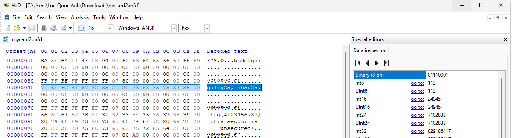
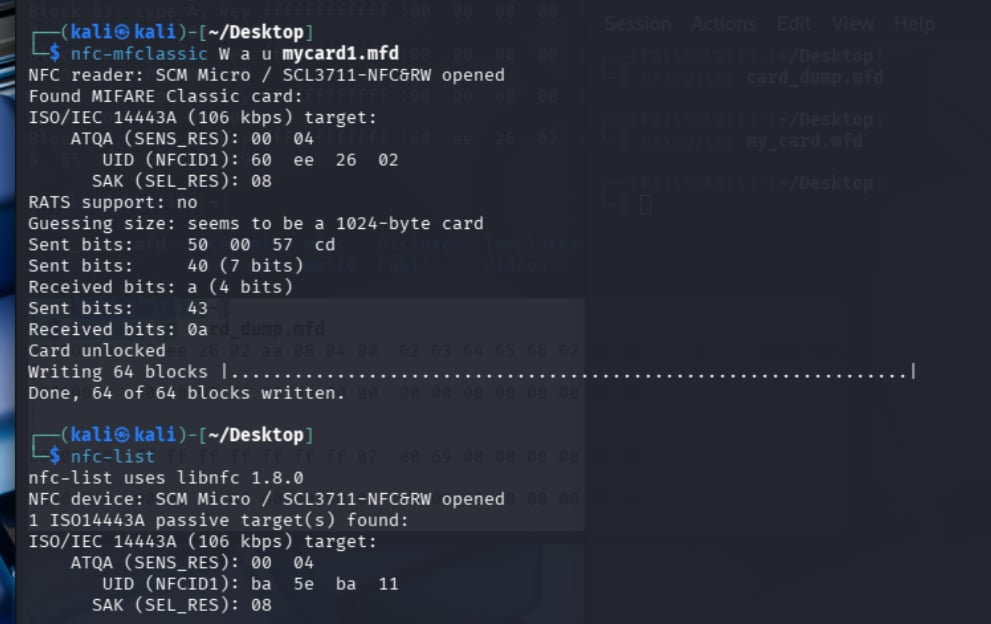

# 02. Breaking a MIFARE Classic 1K Access Token

> **Scope:** Authorised lab exercise against a lab-issued token containing
> synthetic data. The author's ECS usernames (written into the card during the write
> tasks) are shown as `ECSID1, ECSID2` placeholders throughout.

MIFARE Classic is still one of the most widely deployed contactless access
technologies in the world: building doors, lockers, canteens, transit. It is also
cryptographically broken. This walk-through identifies the card, recovers every key,
reads the protected data, works out the access controls, and finally writes to and
clones the card.

---

## Part 1: Fingerprinting the token

Running `nfc-list` returns the card's identifiers, which uniquely fingerprint the chip.

**B1. Type and capacity.** The combination of SAK = `0x08` and ATQA = `00 04` is
the standard signature of an NXP MIFARE Classic EV1 1K. Capacity is 1 KB
(1024 bytes), organised as 16 sectors × 4 blocks × 16 bytes.

**B2. UID and keyspace.** Current UID: `60 EE 26 02`, a 4-byte (32-bit) UID, so
there are 2³² ≈ 4.29 billion possible values.

**B3. ATQA field.** The ATQA (`SENS_RES`) value `00 04` tells the reader the
card's proprietary type and UID length before selection: here, MIFARE Classic 1K
with a 4-byte UID (per NXP's type-identification procedure).

**B4. UID sizes in the wild.** They are not all one size. The common formats are:
- 4-byte (single size): the classic format, but a small keyspace.
- 7-byte (double size): used to avoid collisions as the 4-byte space is exhausted.

**B5. Can keys be read directly?** No. The chip enforces this in hardware:

- Key A can never be read. Authenticate to a sector, read its trailer, and the
  first 6 bytes (Key A) always return `00 00 00 00 00 00`.
- Key B depends on the access bits. If the bits configure Key B *as a key*, it is
  censored like Key A. If they configure it *as data*, it is readable, but then it no
  longer functions as a cryptographic key.

> This is the trap: "the key can't be read" sounds secure, but it only protects against
> *reading memory*. It says nothing about the cipher, which is where this card actually
> fails.

---

## Part 2: Cracking the keys with `mfoc`

`mfoc` (MIFARE Classic Offline Cracker) exploits weaknesses in the Crypto-1 cipher
and its PRNG. It bootstraps from one known key (a default like `FF FF FF FF FF FF`),
then uses a nested authentication attack: authenticating to an already-known sector
leaks enough state to recover the keys of other sectors offline.

**B6. Timing and speedups.** Full recovery of all 16 sectors took ~58.18 s.
Ways to speed it up:
- Better hardware: a dedicated device like a Proxmark3 runs the attack on its
  own MCU, far faster and more stable than a USB reader (which adds latency and can
  crash mid-attack).
- A custom dictionary: `mfoc -f <keyfile>` seeds known/default keys for a specific
  installation, short-circuiting the search for sectors that use standard keys.

---

## Part 3: Reading the protected sectors

With every key recovered, the protected contents become readable.

**B7. Sector 2 (blocks 8-10).** Secured with the default keys. Contents:
```
flag{A123456789} this sector is     unsecured!..
```

**B8. Sector 4 (blocks 16-18).** Uses custom keys, and, amusingly, the keys are
themselves ASCII words:

| Key | Hex | ASCII |
|-----|-----|-------|
| Key A | `43 4F 46 46 45 45` | `COFFEE` |
| Key B | `41 43 43 45 35 35` | `ACCE55` |

Contents:
```
flag{B123456789}this sector was.secure once.....
```

**B9. Sectors 6-9 (binary data).** Each sector uses its own non-default A/B key pair:

| Sector | Key A | Key B |
|--------|-------|-------|
| 6 | `fb ca 81 f0 81 ff` | `a1 b5 63 48 92 11` |
| 7 | `99 99 81 6d eb 0b` | `b0 0b 80 12 43 aa` |
| 8 | `55 65 94 01 2f ee` | `98 76 c0 bb fe 90` |
| 9 | `81 80 31 a0 f0 f9` | `f2 44 39 95 68 03` |

**Identifying the data:** the first 6 bytes of sector 6 are
`47 49 46 38 37 61`, which is ASCII `GIF87a`. That is the magic-number signature of a
GIF image, split across sectors 6-9. Carving those bytes out reconstructs the file, a
nice example of file-format recovery from raw storage using magic bytes.

**B10. The "User Data" byte.** Inside each sector trailer, byte 9 (the byte
following the access-condition bits) is the User Data / General Purpose Byte.
Sector 2 differs from all the others:
- Sector 2: `0xA8`
- Every other sector: `0x69`

---

## Part 4: Access-control bits

Each sector trailer encodes three bits (C1, C2, C3) *per block*, controlling read/
write/auth permissions. Two sectors on this card were configured unusually.

**B11. Sector 4 (access bits `07 88 7F`).** Decoded:

| Block | Bits (C1 C2 C3) | Meaning |
|-------|-----------------|---------|
| 0 (data) | `011` | Key A disabled for data; Key B is master |
| 1 (data) | `011` | same |
| 2 (data) | `011` | same |
| 3 (trailer) | `110` | permanently locked: settings frozen forever |

**Implications:** Key A cannot read or write blocks 0-2; all access requires Key B.
And because the trailer is in the `110` state, the keys and access bits are immutable:
the sector's security configuration can never be changed again.

**B14. Sector 3 (all blocks `111`).** Decoded:

| Block | Bits | Meaning |
|-------|------|---------|
| 0-2 (data) | `111` | absolute denial of access: no read/write with any key |
| 3 (trailer) | `111` | management block permanently locked |

**Implications:** Nothing can be written to the data blocks, and neither keys nor the
access bits in the trailer can ever be modified. Sector 3 is effectively bricked for
writing, by design.

---

## Part 5: Writing and cloning (magic cards)

**B12. Write `ECSID1, ECSID2` into Sector 1, Block 4.** A standard data sector, so a
normal authenticated write works:
1. Encode the string as a 16-byte, null-padded block
   (`<ECSID1,␠ECSID2>` → 16 bytes, trailing `00` padding). *(Actual bytes redacted;
   they decode to the author's usernames.)*
2. Overwrite Sector 1 Block 4 in the card dump with a hex editor.
3. Flash the dump back to the token:
   ```bash
   nfc-mfclassic W a u mycard1.mfd
   ```



**B13. Magic card vs. stock card.**

On a genuine (stock) MIFARE Classic card from the manufacturer, Block 0, the
manufacturer block (UID + BCC + SAK/ATQA + vendor data), is programmed at the
factory and permanently locked. The UID can be read but never written, which is
what makes it a semi-trustworthy anchor.

A "magic" card is a non-genuine clone chip that deliberately relaxes that lock so
the UID/manufacturer block becomes rewritable, which is the key enabler for cloning.
The common variants:

| Type | How it exposes Block 0 | Tell-tale behaviour |
|------|------------------------|---------------------|
| **Gen1 ("UID / backdoor")** | Responds to special backdoor commands (`0x40` / `0x43`) that unlock Block 0 without authentication | Detectable and non-compliant: it answers commands a real card never would |
| **Gen2 ("CUID / FUID")** | Block 0 is writable with an ordinary authenticated write, no backdoor command | Behaves like a normal card; harder to detect (a FUID can be locked once) |
| **Gen3 / Gen4 ("GTU")** | Vendor APDUs or a configuration shadow block to change UID/behaviour | Most flexible; can mimic other card types |

So a stock card has a fixed identity and a magic card has an attacker-controlled one,
which is what lets an attacker go from reading a UID to impersonating it.

**B15. Write into Sector 3, Block 12.** Not possible on this card. As decoded in
B14, Sector 3's data blocks are set to `111` (absolute denial of access), so the card
rejects any write to those blocks regardless of key or tool. The right response is to
recognise the access-bit lockout rather than fight it. *(On a magic card you could
sidestep this by rewriting the whole dump via the backdoor, but the stock access bits
make a normal write impossible, which is the point of the question.)*

**B16. Grant access by cloning UID `0xBA5EBA11`.** Access systems that trust only
the UID can be defeated by cloning that UID onto a magic card, rewriting Sector 0,
Block 0:

1. **Build the new Block 0** (must be exactly 16 bytes):
   `UID (4) ‖ BCC (1) ‖ SAK/ATQA (3) ‖ vendor data (8)`.
   - Target UID: `BA 5E BA 11`
   - BCC checksum = XOR of the UID bytes:
     `BA ⊕ 5E ⊕ BA ⊕ 11 = 4F`
     (the two `BA` bytes cancel, leaving `5E ⊕ 11 = 4F`).
2. Patch bytes 0-4 of Block 0 in the dump with a hex editor (leaving SAK/ATQA/vendor
   bytes valid).
3. Flash to the magic card:
   ```bash
   nfc-mfclassic W a u mycard1.mfd
   ```



---

## Security takeaway

MIFARE Classic fails at every layer this lab touched:

- Cipher: Crypto-1 and its weak PRNG let `mfoc` recover all keys in under a
  minute, so the "keys can't be read" protection is irrelevant once the cipher leaks.
- Identity: UID-only access control is defeated by a £2 magic card. The UID is an
  *identifier*, not a *secret* and not an *authenticator*.
- Configuration: access bits are powerful but fragile. One sector was frozen
  forever by a trailer misconfiguration, which is easy to do by accident.

Defensive guidance: treat MIFARE Classic as providing no security. Migrate access
control to MIFARE DESFire EV2/EV3 or equivalent (AES, mutual authentication, secure
messaging), and never make an authorisation decision on a UID alone.
