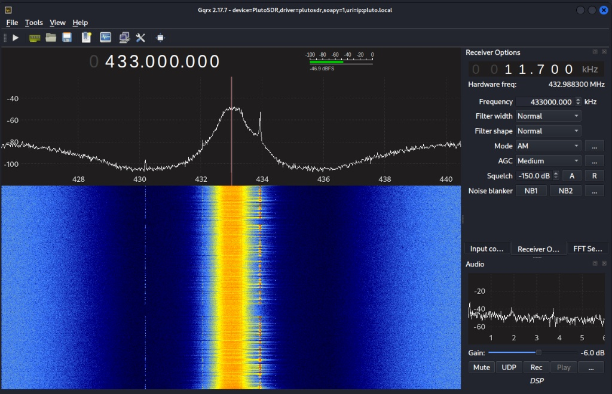
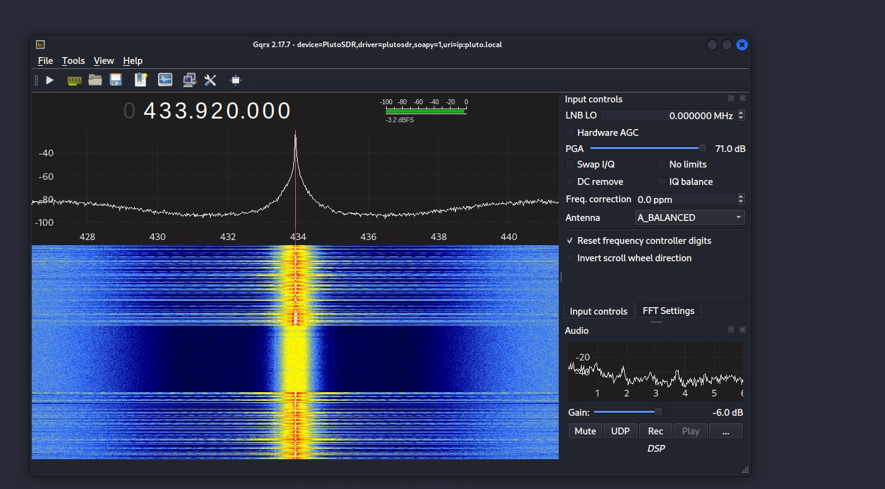
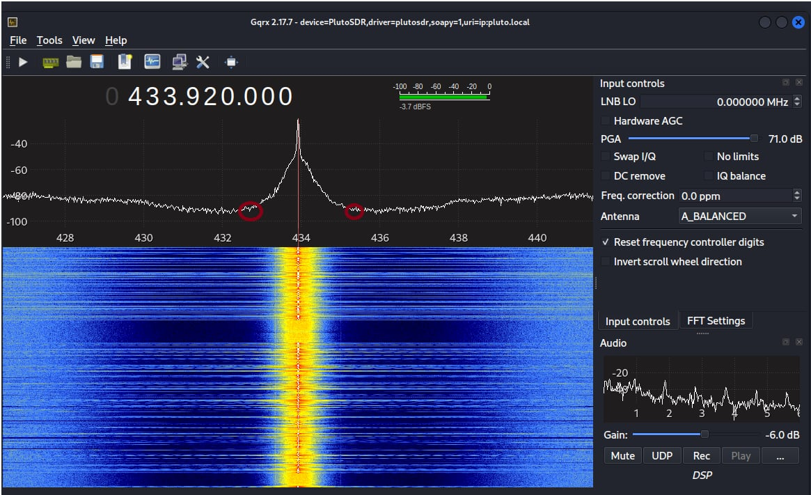
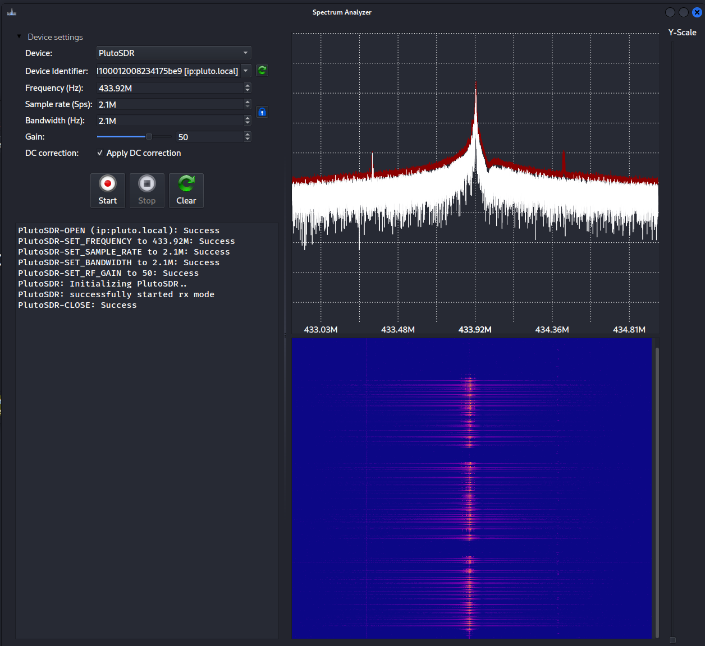
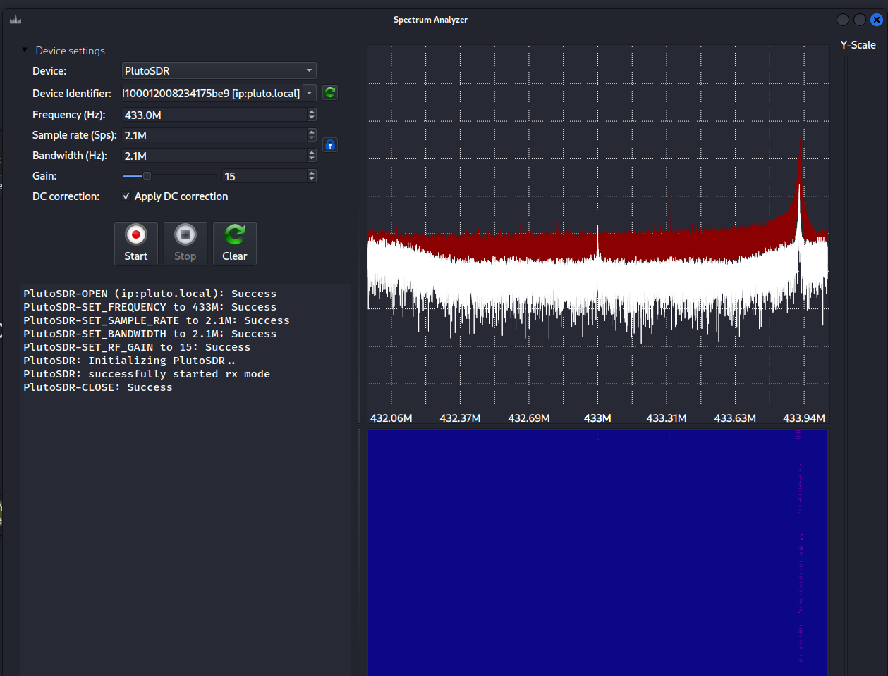

# 02. Finding the Signal and Replaying It

> **Scope:** Authorised lab, short-range transmission to a relay board I control.
> Transmitting to operate devices you don't own is illegal.

With the target understood on paper, this chapter goes live: locate the signal in the
spectrum, then capture and replay it to operate the relay. This is the single most
common real-world RF attack, and it needs no understanding of the protocol at all.

## Part A: Spectrum monitoring (gqrx)

### How sample rate sets what you can see

In gqrx the sample rate equals the visible bandwidth: at 15 MSPS you see a 15 MHz
span centred on the tuned frequency (a consequence of Nyquist, since the complex-sampled
bandwidth equals the sample rate). The PlutoSDR's AD9363 supports up to 61.44 MSPS,
though USB 2.0 realistically caps stable use around 20-30 MSPS.

### Hardware AGC

Automatic Gain Control inside the AD9363 continuously adjusts RF gain. For this
device it helps: it stops the strong OOK bursts from clipping while still lifting weak
signals, giving a clean, stable peak. (On signals where you need absolute amplitude
stability, AGC can be a nuisance, but for simply finding and inspecting an OOK burst
it's ideal.)

### Finding the exact carrier

I started tuned to 433.0 MHz and pressed the remote. A distinct spike and bright
waterfall streaks appeared offset to the right; moving the centre frequency onto the
spike read 433.92 MHz. Re-tuning the hardware to 433.92 MHz and pressing again
produced a tall peak dominating the noise floor, with the characteristic interrupted
horizontal waterfall streaks of OOK sitting exactly on the centre line. That confirmed
433.92 MHz as the transmit frequency (and confirmed the modulation prediction from
[chapter 01](01-target-reconnaissance.md)).




### Measuring the occupied bandwidth

By hovering over where the signal rises out of, and falls back into, the noise floor:

```
lower edge ≈ 432,664 kHz
upper edge ≈ 435,016 kHz
bandwidth  = 435,016 − 432,664 ≈ 2,352 kHz ≈ 2.35 MHz
```



### Why only one peak for four buttons

Pressing A, B, C or D produces a single peak at 433.92 MHz every time. All buttons
share the same carrier; they differ only in the last 4 bits of the 24-bit data frame
(the payload), not in RF frequency, so the spectrum looks identical regardless of
button.

## Part B: Capture and replay (Universal Radio Hacker)

### Objective

Capture the remote's transmission and re-transmit an exact copy to trigger the relay,
with no decoding of the underlying bits.

### Approach

1. **Spectrum Analyser** in URH → PlutoSDR, ~433.92 MHz, 2 MSps, gain tuned by hand.
2. **Capture Signal** while holding a button; saved to disk with a descriptive name.
3. **Trim** the capture in the Interpretation tab: delete the seconds of empty noise
   before/after the press, leaving just the repeating data packets.
4. **Replay** via the transmit window (same frequency & sample rate, gain = 0 / max),
   with the SDR placed ~10-15 cm from the board.

### Real issues and how I solved them

| Issue | Fix |
|-------|-----|
| PlutoSDR not detected | Pressed **Refresh** and restarted URH; device enumerated |
| Gain too high → **clipping** (flat-topped waveform, destroyed data); too low → buried in noise | Adjusted the gain slider live until peaks were tall, distinct and unclipped (a good SNR) |
| Raw capture had seconds of dead air, making replay slow/unreliable | Selected the empty regions and deleted them (backspace), trimming to just the payload for an instant, reliable replay |

The gain trade-off is visible comparing a strong capture to a weak one:




### Result

The trimmed capture, replayed at short range, operated the relay: a successful
replay attack.

## Analysis

### How effective is this attack?

Very, against simple static systems. Replay is the simplest RF attack: capture,
store, retransmit, with no specialist hardware and no knowledge of the data or
modulation. It works here because the device uses static authentication with no frame
counter: every transmission is identical, so a recorded one stays valid forever. (Replay
can even defeat *encrypted* links if the ciphertext never changes.) The only real
prerequisite is a good SNR capture, achievable by being close or using a better antenna.

### Replay vs. full signal reconstruction

| | Replay | Full reconstruction |
|---|--------|---------------------|
| **Knowledge needed** | None: treat the signal as an opaque blob | Deep: demodulation, protocol reverse-engineering |
| **Vs. static encryption** | Bypasses it (re-sends the valid block unchanged) | Blocked by strong payload encryption |
| **Flexibility** | Limited to the exact captured command & its noise | Generate perfect waveforms, arbitrarily change the payload |
| **Vs. rolling codes** | Defeated: old codes are invalidated | Might compute/inject the next valid code |

### Would this work on a car key?

No. Modern car fobs use rolling codes: each press sends a fresh, unique code, and
the car invalidates every previous one once used. A replayed capture is an
already-spent code, so the car rejects it. The static-code weakness that makes this
relay trivial is precisely what rolling codes were designed to remove.

## Security takeaway

A replay attack converts "I can hear your device" directly into "I can operate your
device," with near-zero skill, whenever the transmitted code is static. The defence
isn't a stronger radio or more power; it's freshness: rolling codes, counters, or
challenge-response so that a captured transmission is never valid twice.
