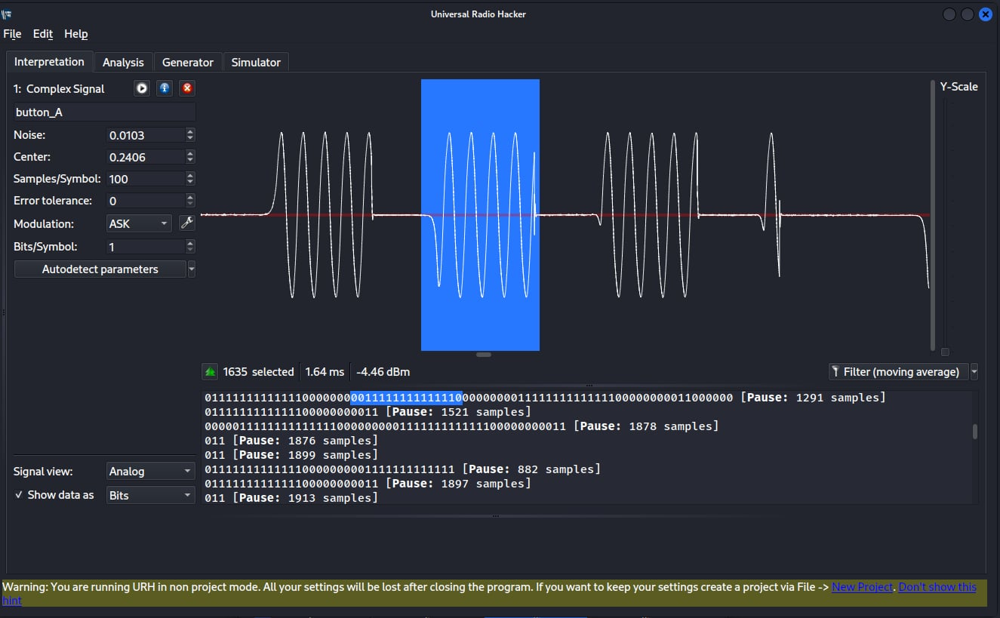
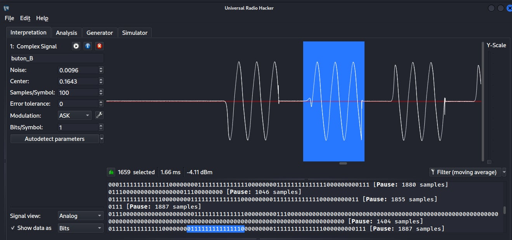
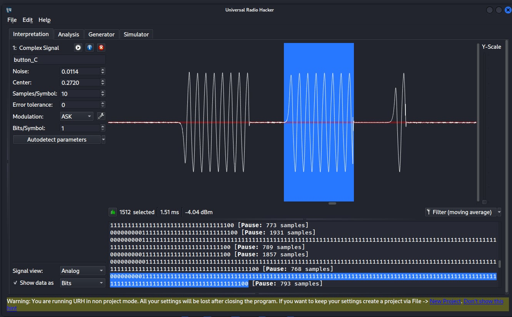
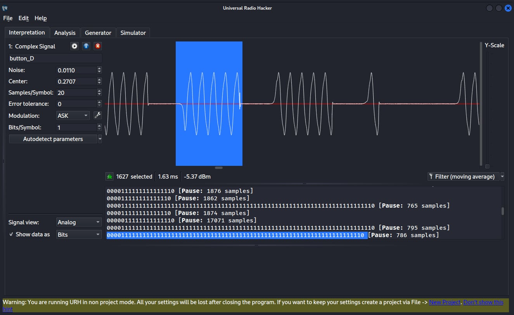

# 03. Decoding the Protocol and Measuring the Keyspace

> **Scope:** Authorised lab, analysis of signals captured from a relay board I control.

Replay proved the device can be operated without understanding it. This final chapter
goes further and reverse-engineers the protocol: decoding the bits, identifying the
encoder chip, and turning that into a concrete security verdict. How big is the
keyspace, and how long would a blind brute force take?

## Context: decoding OOK as ASK

Universal Radio Hacker natively decodes ASK, not OOK, so decoding this device
needs manual tuning: zoom into the analogue waveform, isolate one complete frame, and let
URH convert that selection into a bitstream. OOK is just ASK with the carrier fully on or
off, so with careful frame selection the decoder recovers the data.

## Objective

Determine the repeating unit of the signal, how the four buttons differ, which encoder
chip is used, and the size of the ID space, then judge whether the device is safe for
security-critical use.

## Findings

### The repeating unit

The logical repeating unit is a 24-bit frame: a 20-bit fixed address + a
4-bit button code. It is pulse-width (timing) encoded, and retransmitted ~10-13
times consecutively while the button is held, for reliability.

### How the four buttons differ

Isolating one frame per button and decoding it gives these raw bitstreams:

| Button | Raw decoded bitstream |
|--------|-----------------------|
| A | `011111111111110` |
| B | `011111111111111` |
| C | `00000001111…1110` (long) |
| D | `000011111…111110` (long) |

> **Reading these correctly:** the strings are raw ASK-decoder output, and their
> differing lengths are an artefact of where URH placed pause/edge boundaries at
> different zoom and decoder settings, *not* four genuinely different frame lengths.
> The meaningful fact is that every button shares the same 20-bit address and differs
> only in the 4-bit button field. That's why the spectrum showed one peak for all
> four buttons (see [chapter 02](02-spectrum-and-replay.md)), and it's the key assumption
> behind the keyspace maths below.






### Identifying the encoder: EV1527

The signal matches the EV1527 (1527-series learning-code IC) on every characteristic:

- 24-bit frame = 20-bit address + 4-bit data
- pulse-width timing encoding with short/long pulse widths
- ~11-13 repetitions per press
- fixed 433.92 MHz OOK carrier

All four line up with the EV1527 datasheet; this is the standard chip in low-cost 433 MHz
remotes.

### The keyspace

The EV1527 address field is 20 bits (C0-C19):

```
2²⁰ = 1,048,576 unique device IDs  (~1 million)
```

The 4-bit button field (D0-D3) only selects which of the four buttons/relays. It does
not expand the device ID space.

### Brute-force time

If you can't capture a signal, you can still try every address. From the capture, one
press sends the frame ~13 times, so one full burst is about:

```
13 repetitions × ~2.5 ms per frame (incl. pause) ≈ 32.5 ms  = 0.0325 s
```

Assuming continuous transmission and the relay resetting between attempts, the worst-case
time to exhaust every ID for one relay channel is:

```
1,048,576 × 0.0325 s ≈ 34,079 s ≈ 9.47 hours  (theoretical maximum)
```

Under 10 hours, unattended, with automated tooling: entirely practical.

## Security verdict

This device must not be used in secure or safety-critical roles (access control,
firing pyrotechnics, and the like). Summarising the whole investigation:

- Replayable: static authentication, no rolling code or counter, so a captured
  signal works forever ([chapter 02](02-spectrum-and-replay.md)).
- Brute-forceable: a 20-bit address space falls in under 10 hours.
- Unencrypted: the payload is identical every transmission and trivially intercepted.

## Security takeaway

The EV1527's whole design goal is cost, and security was never part of it. The fixes are
architectural, not incremental: use rolling codes / challenge-response to kill replay,
a much larger keyed space with rate-limiting / lockout to kill brute force, and
authenticated encryption so the payload isn't a reusable constant. For anything where
a wrong actuation matters, this class of device is the wrong tool entirely.
