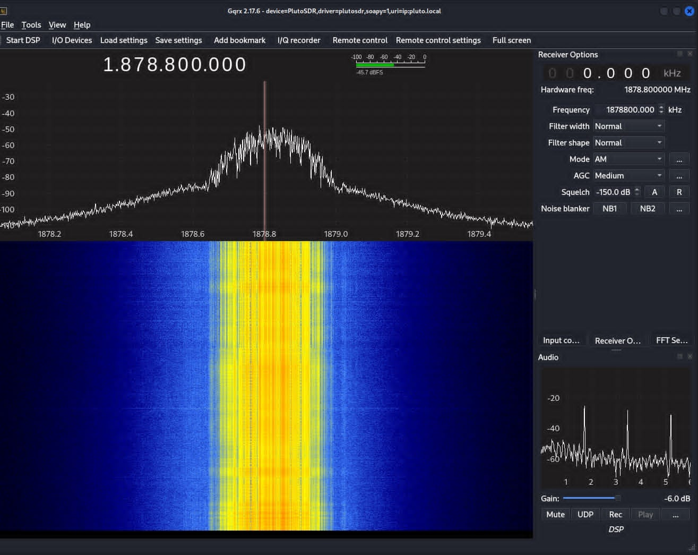
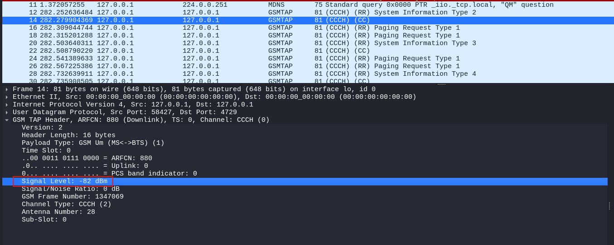
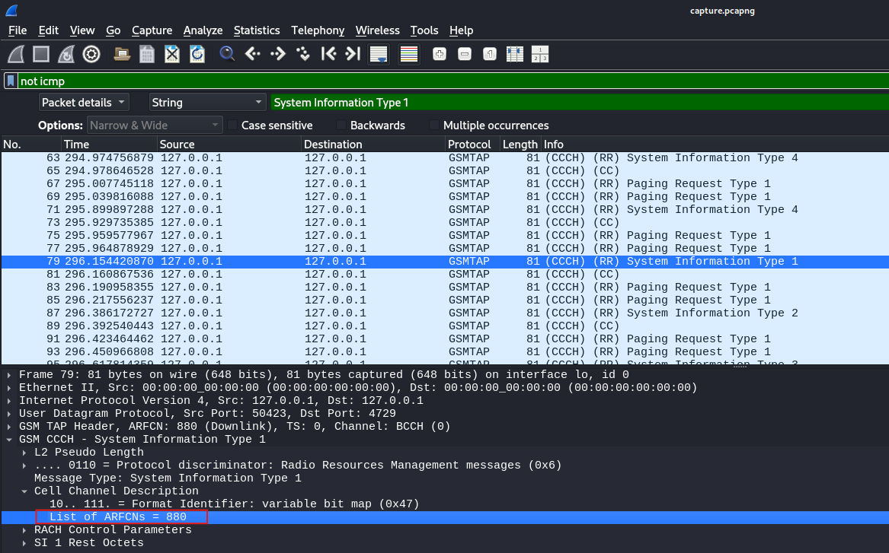
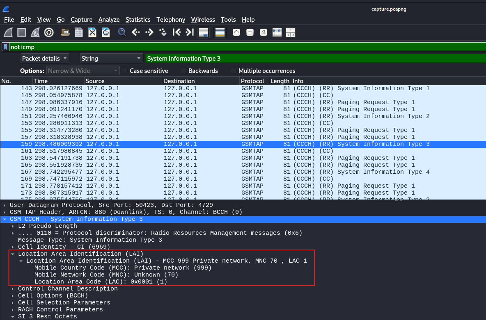
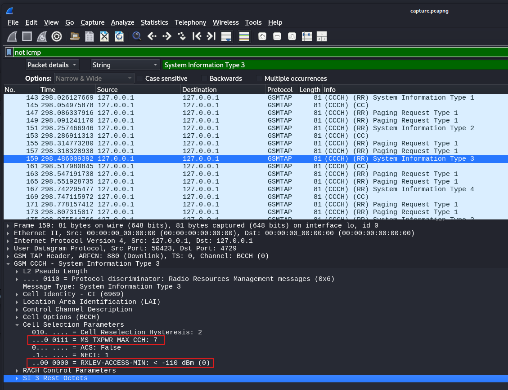
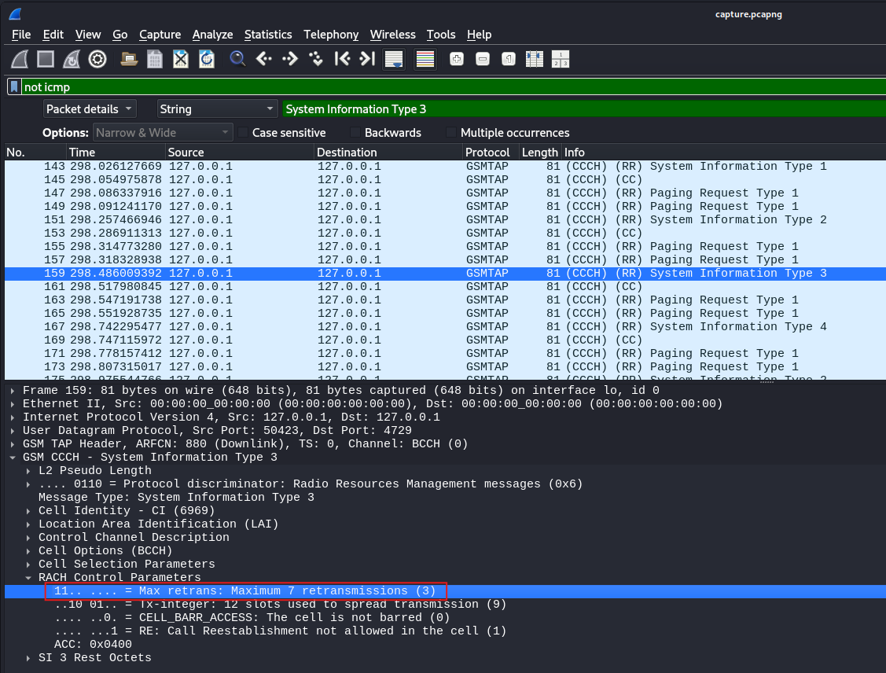
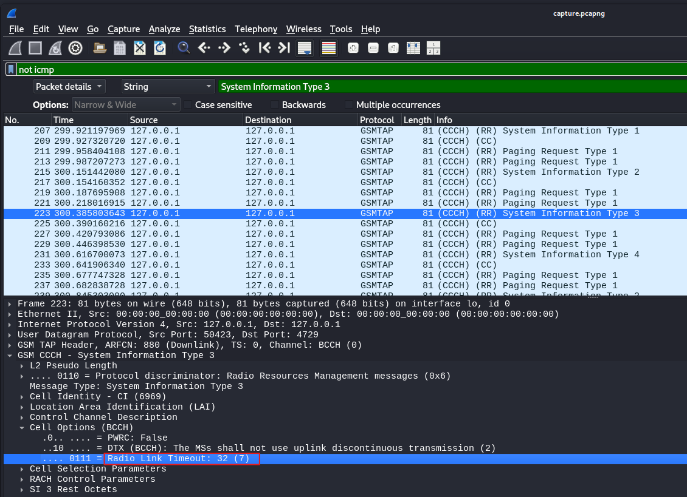

# 02 — Finding the Cell and Sniffing Its Broadcast Parameters

> **Scope:** Authorised lab, private test cell (MCC 999) at 1878.8 MHz only.
> Intercepting real networks is illegal — see the [README](../README.md) note.

With the protocol understood, this chapter goes on air: confirm the cell exists, then
**passively decode everything it broadcasts about itself** — no transmission, just
listening to the one channel GSM sends to everyone.

## Part A — Confirming the signal (gqrx)

Loading gqrx with the PlutoSDR and tuning to **1878.8 MHz** showed the GSM cell as a
clear, solid block on the spectrum — confirming the lab network is live.



**Measured bandwidth.** Reading the signal edges off the spectrum display:

```
lower edge ≈ 1,878,650 kHz
upper edge ≈ 1,878,987 kHz
bandwidth  ≈ 337 kHz
```

**337 kHz vs. the theoretical 200 kHz** per ARFCN — the measured value is wider for
three reasons:

- **Measurement estimate** — edges read by eye off an FFT display are affected by FFT
  resolution, gain and noise floor.
- **Spectral roll-off** — real GSM signals don't have vertical edges; energy tapers
  beyond the 200 kHz channel, so the signal *looks* wider.
- **Adjacent carriers** — nearby active ARFCNs can blur into the measured span.

## Part B — Sniffing the broadcast channel (gr-gsm + Wireshark)

### Approach

`grgsm_livemon` demodulates the live GSM downlink and re-emits the decoded frames as
**GSMTAP** packets on the loopback interface, where Wireshark can dissect them:

```bash
grgsm_livemon -f 1878.8M -s 1e6
```

| Parameter | Meaning |
|-----------|---------|
| `grgsm_livemon` | live monitor — demodulate GSM and output GSMTAP over loopback |
| `-f 1878.8M` | tune to the cell's downlink frequency |
| `-s 1e6` | sample rate 1 Msps |

In Wireshark, selecting the loopback interface and applying the display filter `gsmtap`
isolates the GSM frames. Each **System Information** message can then be expanded field by
field.

### Findings — reading the cell's configuration

Every parameter below was lifted straight from the broadcast System Information packets.

**Received signal level** (from the GSMTAP header): **−82 dBm**.



**Advertised ARFCN** (System Information Type 1 → Cell Channel Description): **880** —
matching the value calculated in [chapter 01](01-gsm-fundamentals.md).



**Operator identity** (System Information Type 3 → Location Area Identification):

| Field | Value | Meaning |
|-------|-------|---------|
| MCC | **999** | reserved for **test networks** — confirms this is a lab cell, not a public one |
| MNC | **70** | the (test) operator code; with MCC 999 it uniquely names this cell |



**Cell selection & access** (System Information Type 3):

| Parameter | Value | Meaning |
|-----------|-------|---------|
| RXLEV-ACCESS-MIN | **−110 dBm** | minimum signal a device needs before it may attempt access |
| MS TXPWR MAX CCH | **power level 7** (≈ 30 dBm / 1 W in GSM-1800) | cap on device transmit power when contacting the cell |



**RACH control** (System Information Type 3 → RACH Control Parameters):

- **Max retransmissions: 7** — a device retries an unacknowledged access attempt up to 7
  times before giving up.



**Cell options** (System Information Type 3 → Cell Options):

| Parameter | Value | Meaning |
|-----------|-------|---------|
| Call re-establishment | **not allowed** (RE field absent) | a dropped call can't auto-reconnect |
| Radio Link Timeout | **32** (coded 7) | tolerate up to 32 consecutive lost SACCH blocks before declaring the link failed and dropping the connection |



## Security takeaway

The broadcast channel is, by design, an open book: a passive listener can completely
**fingerprint a cell** — its identity, operator, access rules and power limits — without
ever transmitting or authenticating. That's acceptable for the control information it was
meant to carry, but it's also the first half of a reconnaissance step. The real exposure
begins when that same passive access reaches **device-specific** traffic — which, on an
unencrypted cell, it does: see [chapter 03](03-intercepting-sms-and-voice.md).
