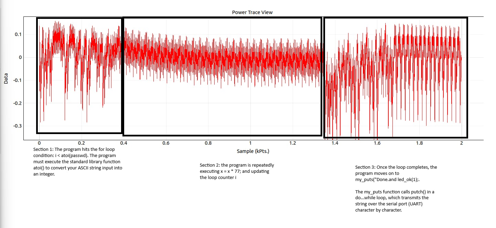
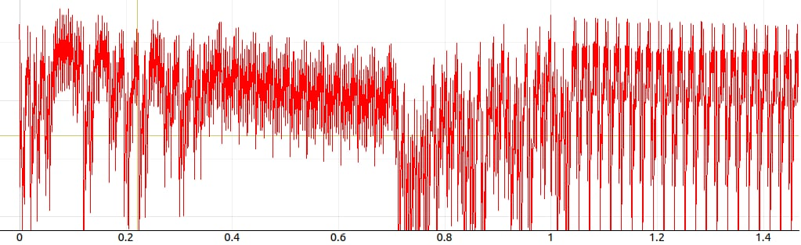
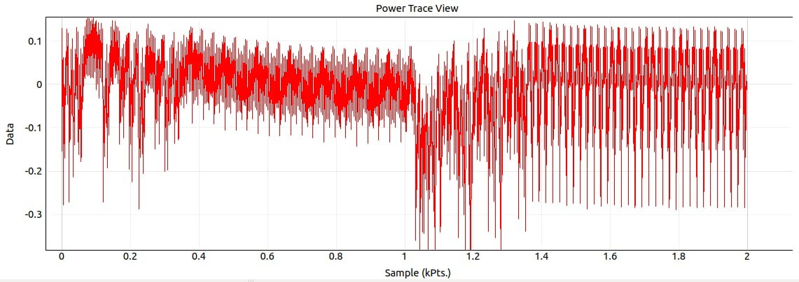
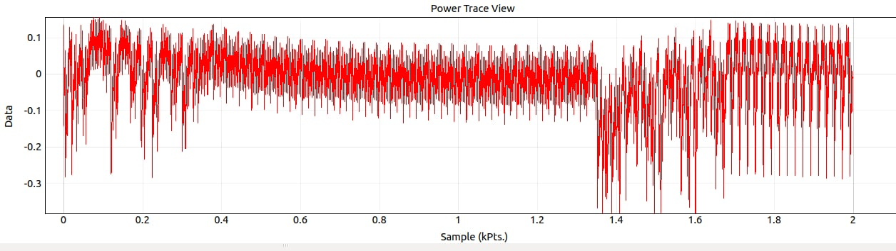
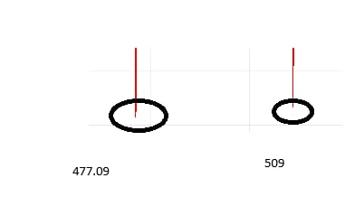

# 01. Learning to Read a Power Trace

> **Scope:** Authorised lab on a ChipWhisperer-Lite training board with lab-provided
> firmware. No real device or secret involved.

Before you can *attack* a device through its power consumption, you have to be able to
*read* it. This chapter sets up the ChipWhisperer platform and then answers a deceptively
simple question: can you look at a power trace and say what code the chip is running?

## Context: the ChipWhisperer platform

The ChipWhisperer-Lite pairs a target microcontroller (an Atmel XMEGA, platform
`CW303`) with a synchronised capture scope on the same board. Two programs drive it:

| | **ChipWhisperer Capture** | **ChipWhisperer Analyzer** |
|---|---|---|
| Role | Acquisition | Offline analysis |
| Does | View/save/edit traces, flash target firmware, run capture scripts, serial terminal, record fixed/random key+plaintext sets, glitch exploring | CPA & profiling attacks, preprocessing (resync, decimation, filtering, normalise), AES key-schedule calculator, correlation/PGE result widgets |

So Capture gathers the traces, and Analyzer breaks them.

**How the board stays synchronised.** The on-board FPGA talks to the target MCU over
four lines, and the synchronisation is what makes these attacks so clean:

| Signal | Pin | Purpose |
|--------|-----|---------|
| `hs2 = "clkgen"` | HS2 | FPGA feeds its 7.37 MHz clock to the MCU, so CPU and ADC sample in lockstep |
| `tio1 = "serial_rx"` | GPIO1 | Serial **RX** (MCU → host) |
| `tio2 = "serial_tx"` | GPIO2 | Serial **TX** (host → MCU: the SimpleSerial `k`/`p`/`x`… commands) |
| `trigger = "tio4"` | GPIO4 | Trigger: the MCU pulls this high to tell the scope "start recording now" |

SimpleSerial is the tiny command protocol over that serial link: `k` load key,
`p` send plaintext (and start the operation), `r` return response, `w` list commands,
`x` flush buffers. For side-channel work its value is control and repeatability:
you choose the plaintext, fire the operation, and the `p` handler brackets the sensitive
code with `trigger_high()` / `trigger_low()` so every capture is aligned identically.

**`trigger_high()` / `trigger_low()`** simply raise and lower GPIO4 around the code of
interest:

```c
trigger_high();
// ... cryptographic / sensitive operation ...
trigger_low();
```

That rising edge is the "starting pistol" for the ADC, giving perfectly aligned traces
run after run.

## Objective

Compile the `ecslabs-countup` firmware (a configurable `for` loop doing `x = x * 77`),
capture its power trace, and correlate the waveform with the source, then quantify a
single loop iteration.

## Findings

### Mapping the trace to the C code

The trace divides into three regions, each a different kind of work:



| Region | Samples | C code | Why it looks that way |
|--------|---------|--------|-----------------------|
| **1. Setup / conversion** | 0 to ~400 | `atoi(passwd)` to evaluate the loop bound | Varied instructions (memory reads, null checks, base-10 math) → erratic, no repeating pattern |
| **2. Counting loop** | ~400 to ~1350 | `x = x * 77;` repeated | The *same* instructions every pass → regular, tightly-packed repeating spikes, one per iteration |
| **3. Output** | ~1350 to 2000 | `my_puts("Done.\n")` over UART | A `do…while` sending one char at a time → a new, wider repeating pattern (per-character transmit) |

Repetition in code becomes periodicity in power: a loop is instantly recognisable because
it draws the same little power signature over and over.

### The input value controls the width

Sending a larger count doesn't change the *shape* of region 2, it changes its *width*:

| Input | Loop region | Observation |
|-------|-------------|-------------|
| 20 | ~sample 400 → ~1000 (~600 samples) | baseline |
| 30 | ~sample 400 → ~1300 (~900 samples) | 10 more iterations → visibly stretched wider |





Each extra iteration appends one more fixed block of power/time, so the count is
*directly readable* as the width of the dense region. That the width encodes the
iteration count is exactly what the password attack in
[the next chapter](02-password-timing-attack.md) exploits.

### How long is one iteration?

Measuring between the start and end of a single spike:

```
start ≈ 477.09   end ≈ 509.00   →  length ≈ 31.91  ≈ 32 samples
```



It is always ~32 samples, because every pass executes the identical machine
instructions (`x = x * 77` plus the counter increment), which take a fixed number of
clock cycles. With the clock (7.37 MHz) and ADC sampling rate held constant, the
per-iteration sample count is deterministic.

## Security takeaway

With no debugger and no source access at runtime, the power trace alone reveals control
flow (setup vs. loop vs. I/O), loop counts, and per-iteration timing. That observability
is the foundation of every attack that follows: if *how much* and *how long* a chip
computes depends on secret data, the secret is leaking.
