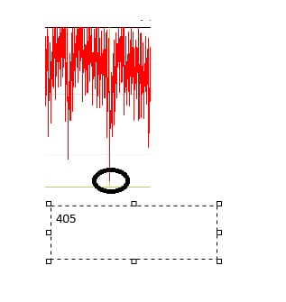
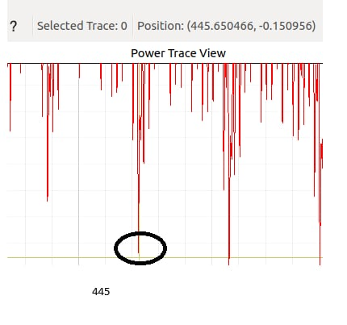
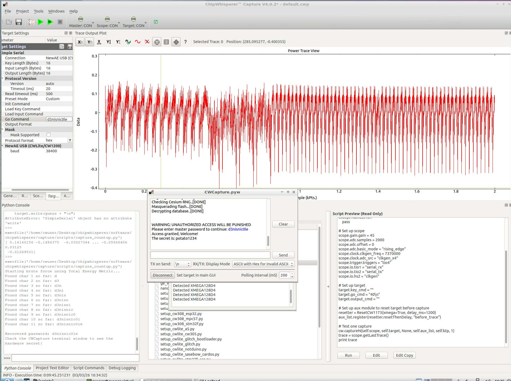
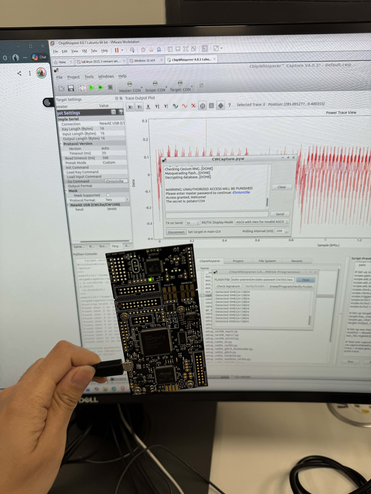

# 02. Cracking a Password Through Timing Leakage

> **Scope:** Authorised lab. The recovered password and secret are synthetic challenge
> values stored in the lab firmware.

Having learned to *read* a trace, we now *attack* with it. The target
(`ecslabs-passwd`) checks an 11-character password one character at a time and
lights a green or red LED. The source and the password are stripped from the binary,
but the timing side channel hands them to us anyway.

## Context: the vulnerability

The target compares the entered password against the secret character-by-character in a
loop. A correct character lets the comparison advance one more iteration before it either
continues or bails out. From [chapter 01](01-reading-power-traces.md) we know an extra
iteration means extra width and extra energy in the power trace. So the number of correct
leading characters is *directly observable*: a classic non-constant-time comparison leak.

The lab hint confirms it: capturing `xxxxxxxxxxx\n` vs. `dxxxxxxxxxx\n` shows an extra
loop appear once the first character is right, so the first character is `d`.

## Objective

Recover the full 11-character password (charset
`abcdefghijklmnopqrstuvwxyz0123456789`) from timing leakage alone, then trigger the
device's success state to read the hidden secret.

## Approach

### Seeing the leak

Comparing a wrong guess to a one-correct-character guess:

| | 0 correct | 1 correct |
|---|---|---|
| Repeating pattern | shorter | visibly wider (an extra wave inserted) |
| A fixed downward spike present on both | ~sample 405 | pushed right to ~sample 445 |




So a correct character shifts a shared landmark by ~40 samples (445 − 405). Getting
a character right literally delays the rest of the program's power signature.

### Choosing a stable metric

The naïve approach reads one fixed sample (e.g. `trace[275]`) and watches it move. But a
single point is fragile to hardware jitter: one noisy capture flips the decision.

Instead I measure the total energy of the whole trace:

```python
def trace_metric(trace):
    return np.sum(np.abs(trace))   # area under the |power| curve
```

Because a correct character makes the target run longer, it produces more total
energy. Integrating over the whole trace averages out jitter, so the correct character
is reliably the highest-energy guess at each position.

### The brute force

For each of the 11 positions, try all 36 characters, capture a trace per guess, and keep
the character with the maximum energy, then lock it in and move on. This is only
`11 × 36 = 396` captures, versus `36¹¹ ≈ 1.3 × 10¹⁷` for a blind brute force: the side
channel collapses an exponential search into a linear one.

```python
for position in range(11):
    best_char, best_metric = 'a', 0
    for c in charset:
        password[position] = c
        trace  = capture_for_guess("".join(password) + "\n")
        metric = trace_metric(trace)
        if metric > best_metric:
            best_metric, best_char = metric, c
    password[position] = best_char      # highest-energy guess wins
```

Full script: [`src/bruteforce.py`](../src/bruteforce.py). It reuses the lab's
`capture_countup.py` scope setup and resets the target before every capture for clean,
aligned traces.

## Findings

- **Recovered password:** `d3nisnic0le`
- **Hidden secret** (printed on success, green LED): `potato1234!`




## Security takeaway

This is a timing attack enabled by an early-exit, character-by-character comparison.
The fix is a constant-time comparison: always compare all characters and combine
the results (e.g. OR the XOR differences) so execution time is independent of how many
characters match. More broadly, never let secret data influence control flow or loop
counts in a way an attacker can observe. The same principle, applied to a cipher's inner
rounds, is what the [CPA attack](03-cpa-aes-key-recovery.md) exploits next, where the leak
is in *power* rather than time.
