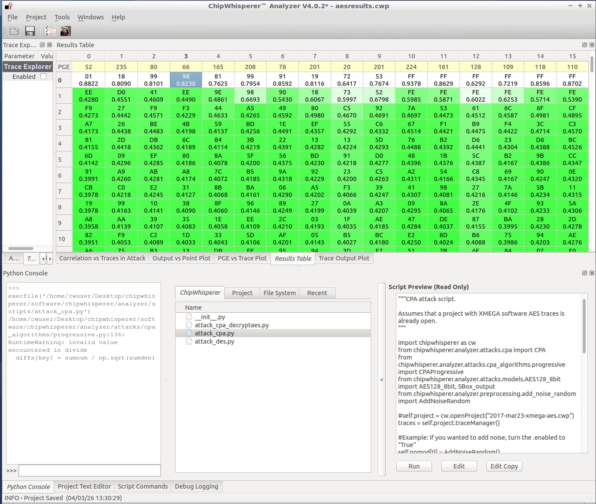
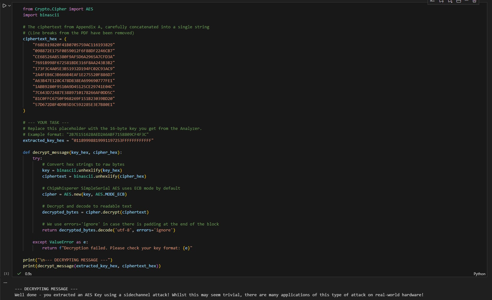

# 03 — Recovering an AES-128 Key with Correlation Power Analysis

> **Scope:** Authorised lab. The AES key and message are synthetic challenge values in
> the lab firmware.

The timing attack broke a password by watching *how long* the chip ran. This final
attack goes after real cryptography: an AES-128 key hidden inside the firmware, recovered
by statistically correlating *how much power* the chip draws with a model of what it
should draw — **Correlation Power Analysis (CPA)**. Then we use the key to decrypt the
challenge ciphertext.

## Context — what CPA is

CPA extracts a secret key not by guessing the whole key, but by **statistically relating
measured power to predicted power** for one small piece of the key at a time.

It improves on classical **Differential Power Analysis (DPA)**: instead of splitting
traces into two bins on a single bit, CPA uses a **multi-bit leakage model** (here,
Hamming weight of the AES S-box output) and computes a **Pearson correlation
coefficient** between predicted and actual power — extracting more information per trace.

The attack is **divide-and-conquer**: the 16-byte key is attacked **one byte at a time**,
so the search is `16 × 256 = 4096` hypotheses rather than `2¹²⁸`.

## Objective

Capture power during AES encryption on the `ecslabs-aes` target, run a CPA attack in the
Analyzer to recover all 16 key bytes, and decrypt the Appendix-A message.

## Approach

1. **Capture.** Using `setup_cwlite_xmega_aes.py`, take **100 traces** with the "Many"
   capture mode — each trace is the power during `aes_indep_enc(pt)`, aligned by the
   `trigger_high()` fired immediately before encryption. Save the project.
2. **Model the leakage.** In the Analyzer, select the **`AES128_8bit` / S-box-output**
   leakage model: it assumes power correlates with the Hamming weight of the first-round
   S-box output, `SBox(plaintext_byte ⊕ key_byte)`.
3. **Predict per hypothesis.** For a target byte, for each of the 256 possible key
   values, combine the guess with the known plaintexts to predict the S-box output and
   its Hamming weight → a predicted-power column.
4. **Correlate.** The `CPA()` engine correlates each of the 256 predicted columns against
   the measured traces.
5. **Pick the peak.** The guess with the **highest correlation** is the real key byte — a
   sharp spike on the correlation plot where model and hardware line up.
6. **Repeat** for subkeys 0–15 to reconstruct the full 128-bit key.

`attack_cpa.py` drives this in the Analyzer.

## Findings

### The recovered key

```
01 18 99 98 81 99 91 19 72 53 FF FF FF FF FF FF
```



*(The trailing `FF`s are part of the challenge key as stored — a reminder that the
attack reads whatever the hardware actually uses, odd-looking or not.)*

### Decrypting the message

The ChipWhisperer SimpleSerial AES target uses **ECB mode**, so decryption is a direct
ECB decrypt of the Appendix-A ciphertext with the recovered key. See
[`src/decrypt_aes.py`](../src/decrypt_aes.py):

```python
cipher = AES.new(binascii.unhexlify(key_hex), AES.MODE_ECB)
plaintext = cipher.decrypt(binascii.unhexlify(cipher_hex)).decode('utf-8', errors='ignore')
```

Recovered plaintext:

> *"Well done — you extracted an AES Key using a sidechannel attack! Whilst this may seem
> trivial, there are many applications of this type of attack on real-world hardware!"*



### Improving the attack

- **More traces** — the simplest lever; going from tens to hundreds (or thousands) of
  traces gives the correlation more statistical power and sharpens the peak.
- **Better statistics** — combining Pearson with rank (Kendall) correlation, or following
  CPA with a **lattice attack** to recover bytes the correlation leaves ambiguous.
- **Signal processing** — time–frequency methods (STFT, wavelet scatter transform) and
  trace resync/filtering reduce the number of traces needed.
- **Efficiency** — parallelised / combined (horizontal + vertical) CPA variants to cut
  the trace count further.

## Security takeaway

CPA shows that a mathematically strong cipher can be defeated by its **physical
implementation**: the S-box output leaks through power, one byte at a time, and 100
traces are enough on an unprotected target. Defences live in the implementation, not the
algorithm — **masking** (randomise intermediate values so Hamming weight no longer tracks
the secret) and **hiding** (added noise, jitter, dual-rail logic, shuffling) to break the
correlation between power and data. This is why certified secure elements and smartcards
invest so heavily in side-channel countermeasures.
